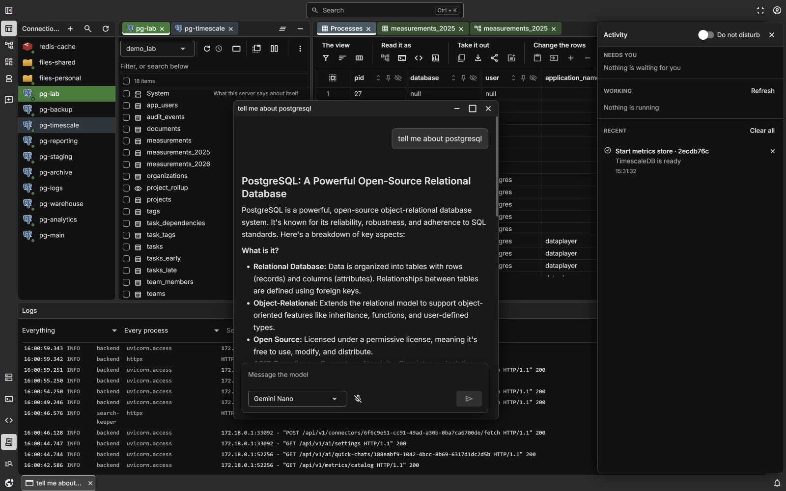
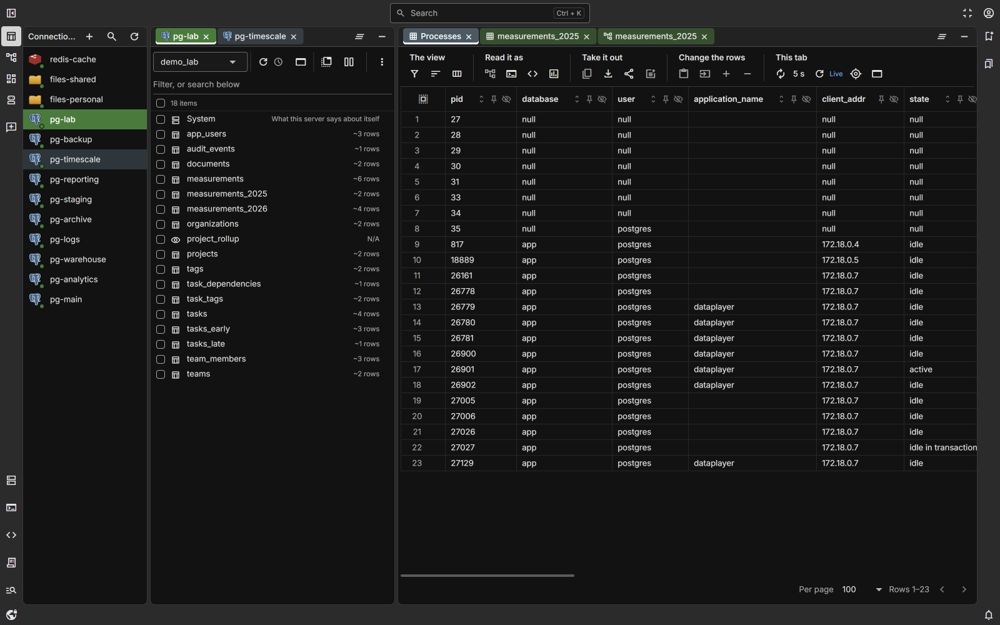
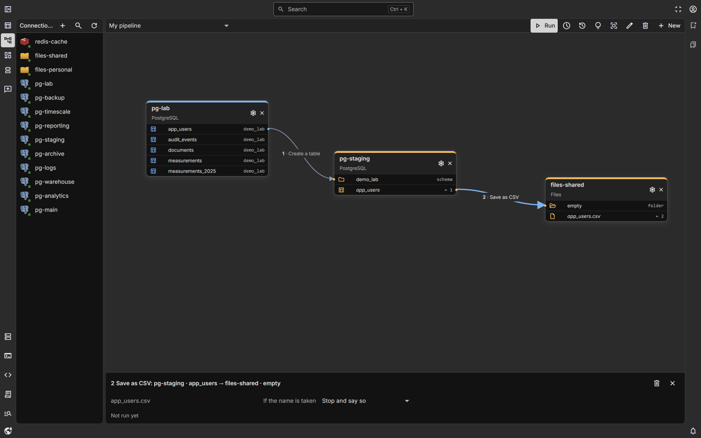
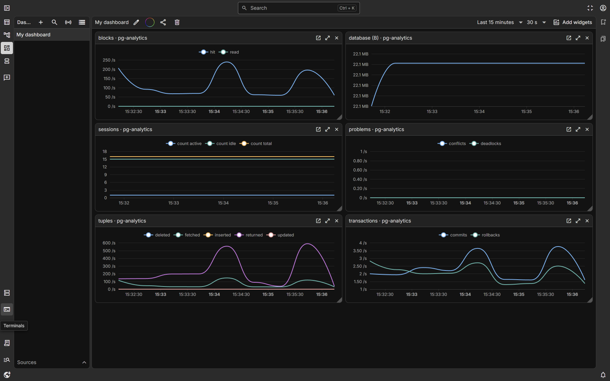
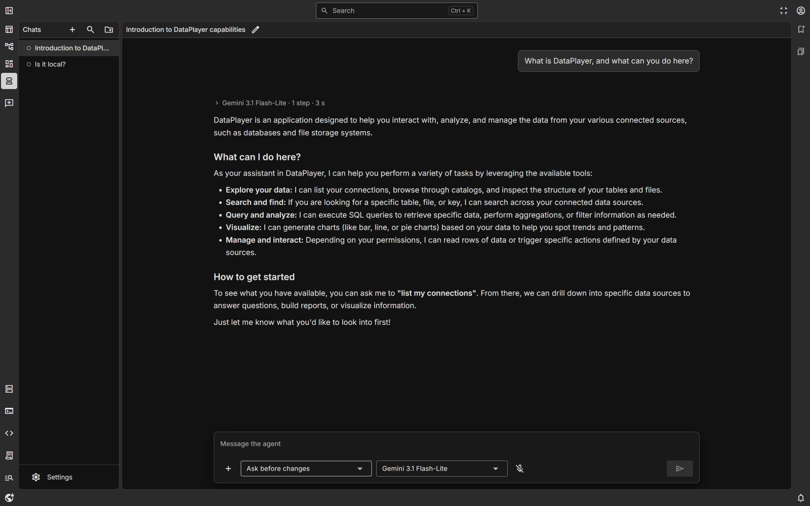

# DataPlayer

One web interface for the data sources you work with: browse what is in them,
query and edit them, move data between them, watch them, and hand routine
work to an AI agent that uses the same connections you do.

DataPlayer runs on your own machine or server with Docker Compose. Credentials
are encrypted at rest and never leave the backend.



| | |
| --- | --- |
|  |  |
| **Data** — a catalog per connection and a grid of rows | **Pipelines** — steps between connections, run as one |
|  |  |
| **Dashboards** — metrics from connection polls and agents | **AI agent** — works through the same connections you do |

## What it does

**Sources**

- **PostgreSQL**, including TimescaleDB: hypertables, chunks, policies and
  continuous aggregates.
- **Redis**: the key space as a tree grouped by `:`, every value type read as
  rows.
- **Files** on the server, and **SSH servers**: a file explorer with preview,
  upload and download, and a terminal in the browser.

A connection is added through a form generated from the source's own schema,
or by pasting a connection string, and is checked before it is saved.

**Working with data**

- A catalog per connection, with filtering and search by name.
- A data grid with sorting, filters, inline editing, inserts and deletes,
  charts, and download of the current page or every row.
- A SQL editor with history, saved query documents, Explain, and explicit
  transactions.
- A table designer for columns, indexes and constraints; every change is
  shown as the statement it will run before anything is sent.
- References drawn by hand between columns, even across connections, and
  relationship diagrams in 2D and 3D.
- Copying rows and whole tables between connections, and loading files in.

**Running things**

- Pipelines of steps between connections, run on demand or on a schedule,
  with a history of runs.
- Dashboards fed by connection polls and by a small metrics agent installed on
  your machines.
- Managed services: start a database or cache in a container from a template,
  and back up and restore databases.
- Share links to a tab, with access requests.

**AI agent**

- A chat that can list, read and change your sources through tools, asking
  before every change by default. Works with several model providers; you
  bring your own API key.

**Everywhere**

- One search over connections, their contents and everything the application
  keeps (`Ctrl + K`).
- A workspace of draggable panels and tabs, floating windows, and several
  light and dark themes.

## Stack

| Layer | Technology |
| --- | --- |
| Backend | Python 3.14, FastAPI, SQLModel over async SQLAlchemy, PostgreSQL, Alembic |
| Frontend | Vue 3, TypeScript, Quasar, Vite, TanStack Query, Pinia |
| API client | Generated from OpenAPI, so types run end to end |
| Tests | pytest, Vitest, Playwright |

## Getting started

All it needs is Docker. From the repository root:

```bash
docker compose -f compose.setup.yml run --rm setup
docker compose up -d --build
```

The first command asks a few questions — what for, which preset, the
superuser's email and password, and, to run it, the address people open and
whether to allow managed services — and writes `.env`. Every secret is
generated; one already in `.env` is never replaced. Before writing it lists
every line it changes. Running it again later changes the mode or preset of
the same installation. The second command starts what `.env` now names, and
so does every later `docker compose` command.

| Preset | Starts | Adds |
| --- | --- | --- |
| `minimal` | db, the API, metrics and search-keeper | — |
| `standard` | and a Redis | a read cache shared by the processes |
| `full` | and a local model | search by meaning; the model is downloaded on the first start |

| | Run it (`prod`) | Develop it (`dev`) |
| --- | --- | --- |
| You need | Docker | Docker, [Bun](https://bun.sh) and Node.js |
| Interface | built into the image, on `APP_PORT` (8000) | Vite dev server on 5173, reloading on every edit |
| Data at the start | the first superuser only | sample databases, files and references |
| Default preset | `minimal` | `full` |

Without a terminal, or with `--yes`, it asks nothing and takes its flags:
`--mode`, `--preset`, `--superuser EMAIL`, `--enable-services` or
`--disable-services`. They go after the service name:

```bash
docker compose -f compose.setup.yml run --rm setup python scripts/setup.py --mode prod --preset standard --yes
```

`python scripts/setup.py` does the same where Python is installed.

### Run it

Open the address the setup printed and sign in as the superuser; a generated
password is printed once and stays in `.env` as `FIRST_SUPERUSER_PASSWORD`.
The port speaks plain HTTP: to reach DataPlayer from outside this machine, put
a reverse proxy that terminates HTTPS in front of it (Caddy, Traefik, nginx)
and give its address to the setup. Back up the Docker volume
`dataplayer_app-db-data`; it holds everything DataPlayer keeps.

### Develop it

```bash
cd frontend && bun install && bun run dev
```

The interface is at http://localhost:5173, the API at http://localhost:8000
and its interactive docs at http://localhost:8000/docs. To fill the connections
panel with examples — the bundled PostgreSQL under several names, file storage
and Redis — run `bun run seed:connectors` from the repository root. Adminer
and the test Redis and SSH server start on request:
`docker compose --profile tools up -d`.

The backend cannot run natively on Windows: psycopg 3 in async mode is
incompatible with the event loop Python selects there. Use Docker.

## Working on it

Coding agents and people start in the same place:

- [AGENTS.md](AGENTS.md) — what the project is, where to read the rest,
  commands and traps. Read this before changing anything.
- [ENGINEERING.md](ENGINEERING.md) — how code is written here, and what
  enforces each rule.
- [docs/architecture/](docs/architecture/) — what exists in each area, the
  decisions behind it, and where it falls short.
- [docs/decisions/](docs/decisions/README.md) — the design history: why each
  decision was taken.

## License

DataPlayer is licensed under the [Apache License 2.0](LICENSE). It began from
the [FastAPI full-stack template](https://github.com/fastapi/full-stack-fastapi-template);
the little of that code that remains is used under the MIT License, as
[NOTICE](NOTICE) records.
